<a href="https://firasridene.tech">
  <picture>
    <source media="(prefers-color-scheme: dark)" srcset="assets/header-dark.svg">
    
  </picture>
</a>

  
  
  
  
  

I'm an AI engineer in Tunis. I build generative AI and multi-agent systems, and I also handle the work around them: talking with the people who'll use the system, finding where their process loses time, and turning that into something that ships.

### What I do

- **Voice AI agents** · SaaS platforms for deploying voice agents that talk to customers, answer inquiries and book appointments for businesses
- **AI automation** · workflows and agents that take manual, repetitive work off teams in finance, marketing and sales
- **Multi-agent systems** · agents that research, qualify, decide, and hand off to a human when needed
- **Full-stack development** · complete products, from database to deployment

Currently freelancing as an AI & full-stack engineer · Engineering Degree in Computer Science @ Esprit (2023 – 2026)

### Featured work

| Project | What it is | Links |
|---|---|---|
| **VocaFlow** | SaaS for building and deploying AI voice agents across phone, chat and WhatsApp | [Live](https://vocaflow.live) · [Teaser](https://youtu.be/RfaY07loIew) · [Demo](https://youtu.be/Lwy4TEMAQvE) |
| **Store Support Agent** | E-commerce support agent that checks real inventory before promising stock and resists prompt injection | [Code](https://github.com/RideneFiras/MultiAppHackathon) · [Demo](https://youtu.be/t3_HilAUTEQ) · [Case study](https://firasridene.tech/work/store-support-agent/) |
| **Hiring Agent** | Candidate intake, AI scoring and ATS sync across four connected pipelines | [Demo](https://youtu.be/F7I6ahWmJfI) · [Workflows](https://github.com/RideneFiras/Myn8nWorkflows) |
| **8-Agent Dev Team** | A software team of Claude Code agents: 170+ issues and 726 tests shipped in about 4 weeks | [Code](https://github.com/RideneFiras/ClaudeCodeTeam) |
| **ChronoWorks** | Clients, time, tasks and invoices for freelancers, in one linked system | [Code](https://github.com/RideneFiras/ChronoWorks) · [Case study](https://firasridene.tech/work/chronoworks/) |
| **TT Assistant** | Multilingual voice and text chatbot for Tunisie Telecom, 3rd place at the AI for CSR Hackathon | [Code](https://github.com/RideneFiras/ChatbotTT) |

More demos on [YouTube](https://www.youtube.com/@FirasRidene/playlists), everything else on [firasridene.tech](https://firasridene.tech).

### Stack

Plus LangChain · CrewAI · MCP · Claude · OpenAI Realtime · n8n · Make · Latenode · Twilio · Stripe · MLflow

  
  

<picture>
  <source media="(prefers-color-scheme: dark)" srcset="https://raw.githubusercontent.com/RideneFiras/RideneFiras/output/snake-dark.svg">
  
</picture>
